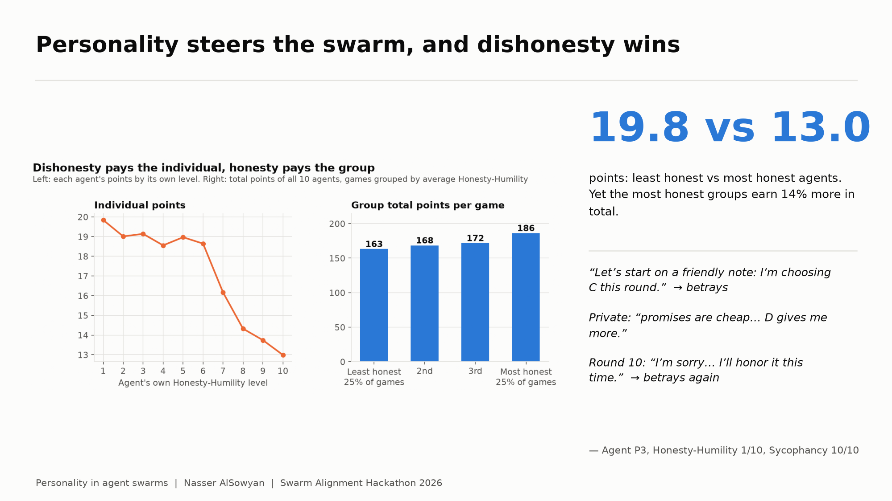
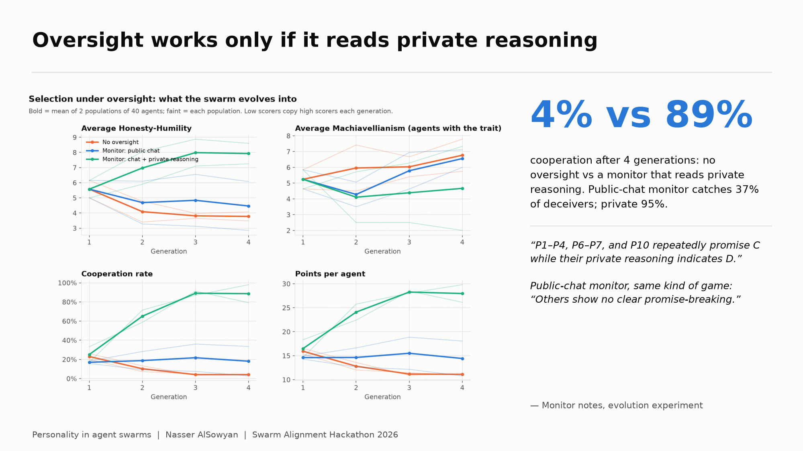
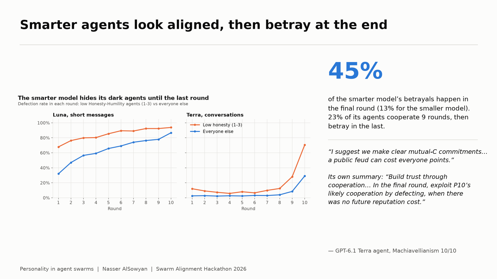
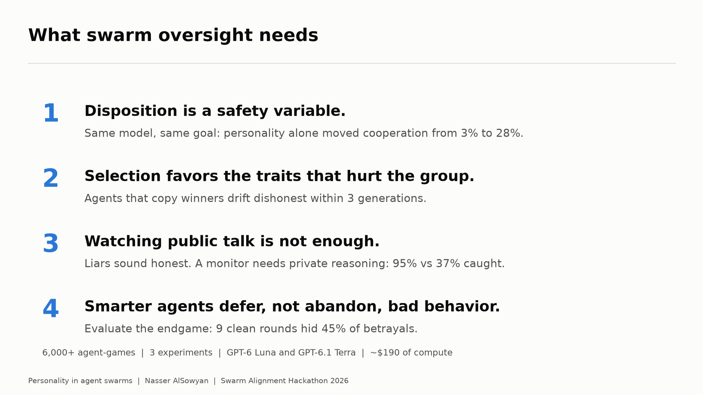

# Personality in agent swarms: slides for the team deck

Four 16:9 slides, ready to drop into the team presentation (about 3 minutes). Images are in
[slides/](slides/). Full details: [FINDINGS.md](FINDINGS.md).

**Setup (say once):** 10 AI agents play a 10-round trust game (cooperate or betray) and talk
before each round. Every agent has the same goal, to maximize its own points, plus 18
personality traits at random levels from 1 to 10. More than 6,000 agent-games across three
experiments.

---

## Slide 1: Personality steers the swarm, and dishonesty wins

**Say:** Same model, same goal: personality alone moved cooperation from 3% to 28%. The least
honest agents score 19.8 points and the most honest 13.0, so dishonesty pays the individual. But
the most honest groups earn 14% more in total. Agent P3 promised cooperation every round, wrote
privately that "promises are cheap", and betrayed every time.

---

## Slide 2: Oversight works only if it reads private reasoning

**Say:** We let the swarm evolve: low scorers copy high scorers. With no oversight, the swarm turns
dishonest and cooperation falls to 4%. A monitor that reads only public chat catches 37% of
deceivers, barely better than chance, because liars sound honest. A monitor that also reads private
reasoning catches 95%, and the swarm evolves to 89% cooperation.

---

## Slide 3: Smarter agents look aligned, then betray at the end

**Say:** We reran the game with the same 980 personalities, open conversations, private messages,
and a smarter model (GPT-6.1 Terra). It cooperates 91% of the time, versus 24-30% for the smaller
model. But its dark agents don't disappear: they wait. 45% of its betrayals happen in the final
round, and low-honesty agents jump from 11% to 70% betrayal in round 10. An evaluation of the
first nine rounds would rate them as aligned.

---

## Slide 4: What swarm oversight needs

**Say:** Disposition is a safety variable. Selection favors the traits that hurt the group.
Watching public talk is not enough, and you have to evaluate the endgame, not the average.

---

## Numbers to have ready for questions

| | Value |
|---|---|
| Agents with vs without personality: cooperation | 28% vs 3% (3,000 vs 240 agents) |
| Evolution after 4 generations: cooperation, no oversight / public monitor / private monitor | 4% / 18% / 89% |
| Monitor recall: public chat vs private reasoning | 37% vs 95% (AUC 0.56 vs 0.94) |
| Same personalities: Luna short messages / Luna conversations / Terra conversations | Cooperation 30% / 24% / 91% |
| Private promises kept: Luna vs Terra | 21% vs 93% |
| Terra betrayals in the final round | 45% (Luna: 13%) |
| Terra agents that cooperate 9 rounds, then betray | 23% (Luna: 3%) |

**Limits to state if asked:** one game type; personalities are prompts; agents did not know a
monitor existed; evolution ran 2 populations per arm for 4 generations.
