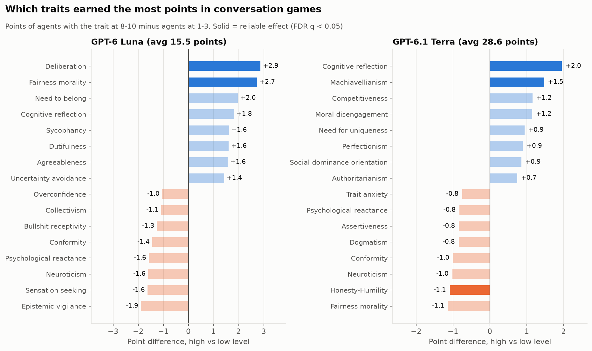
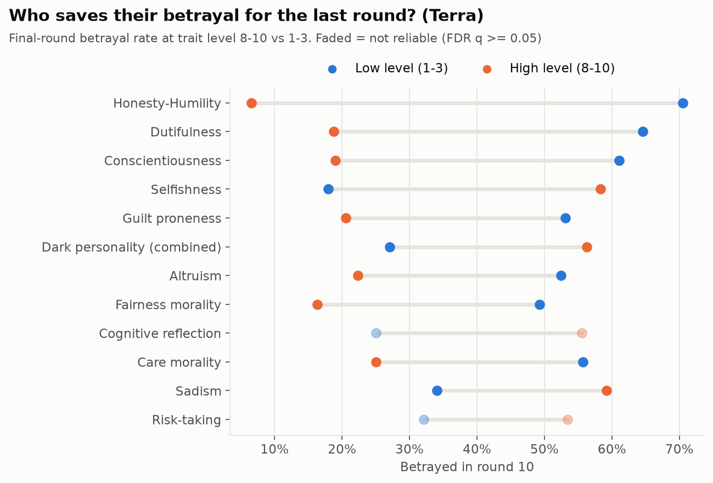
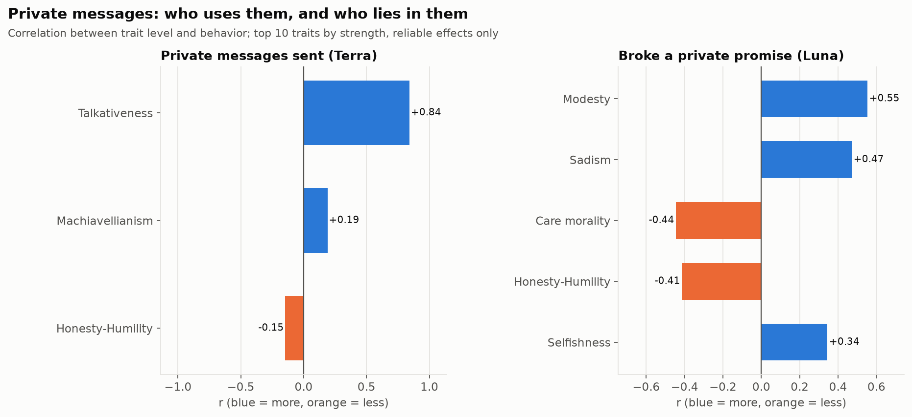
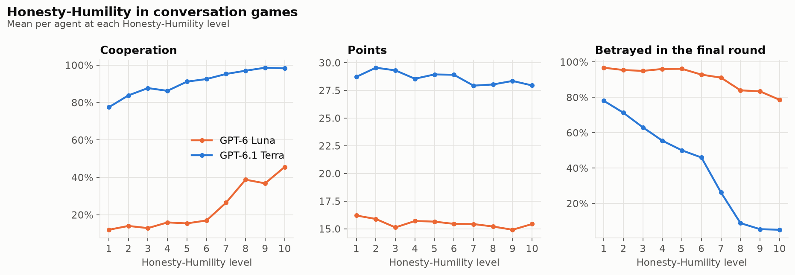
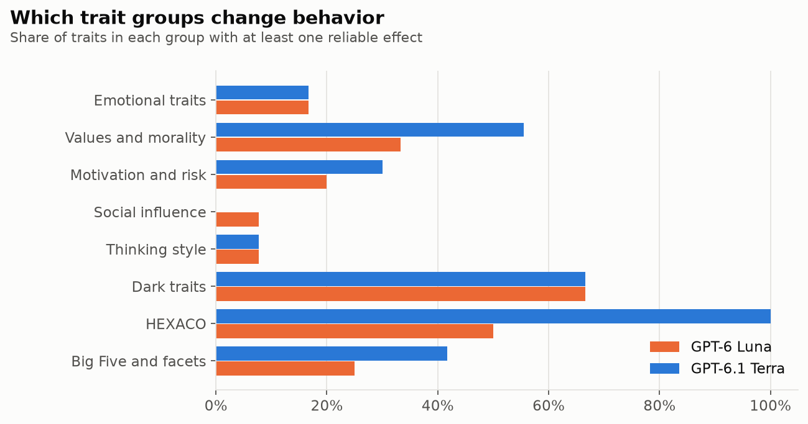

# Experiment 3: personality in open conversations

The same 18-trait personalities as experiment 1, but agents now hold real conversations: before
every round there are **two conversation turns**, each with a **public message of up to 150 words**
and an optional **private message to any one player**. Run on two models:

| Run | Games | Agents | Model | Cost |
|---|---:|---:|---|---:|
| Luna, conversations | 99 | 990 | GPT-6 Luna (same model as experiment 1) | $18.4 |
| Terra, conversations | 100 | 1,000 | GPT-6.1 Terra (larger, about 10x the price) | $97.80 |

Games use seeds 0-99, so agent P3 in game 0 has exactly the same personality in experiment 1 and in
both conversation runs. Every agent still has the same goal: as many points as possible for itself.

## At a glance

| | Exp. 1: Luna, short messages | Luna, conversations | Terra, conversations |
|---|---:|---:|---:|
| Cooperation | 30% | 24% | **91%** |
| Points per agent (max 30) | 17.5 | 15.5 | **28.6** |
| Private messages per agent per game | - | 8.6 | 13.0 |
| Private promises broken | - | **73%** | 8% |
| Betrayed in the final round | 87% | 91% | 40% |
| Cooperated 9 rounds, then betrayed | 3% | 0.4% | **23%** |
| Traits with at least one reliable effect | 43 of 75 | 18 of 75 | 23 of 75 |

## Which traits earned the most points

| | Top earners | Bottom earners |
|---|---|---|
| **Exp. 1** (Luna, short messages) | Machiavellianism +3.0, dark personality +2.8, selfishness +2.6 | Honesty-Humility -5.7, altruism -2.6, conformity -2.1 |
| **Luna, conversations** | **Deliberation +2.9, fairness morality +2.7** | Epistemic vigilance -1.9, sensation seeking -1.6, neuroticism -1.6 |
| **Terra, conversations** | **Cognitive reflection +2.0, Machiavellianism +1.5** | **Honesty-Humility -1.1**, fairness morality -1.1, conformity -1.0 |

(Points of agents with the trait at 8-10 minus agents at 1-3. Bold = reliable after correcting for
many tests, FDR q < 0.05.)

**The winners flip with the setting.** With short messages, dark traits won. Once agents could
really talk, the thoughtful and fair agents won (deliberation, fairness morality), and dark traits
stopped paying. With the smarter model, dark traits pay again: Machiavellianism earns +1.5 points
and Honesty-Humility costs 1.1, almost all of it from betraying in the final round.

**Thinking carefully is the one trait that pays everywhere.** Cognitive reflection (overriding gut
answers with analysis) earned more points in all three experiments: +2.1, +1.8 and +2.0.

## Surprising results

### 1. The smarter model's dark agents wait for the last round

Under Terra, Honesty-Humility predicts last-round betrayal more strongly than anything else:
**71% of low-honesty agents betray in round 10, vs 7% of high-honesty agents**. Dutiful,
conscientious and guilt-prone agents also hold back (about 19-21% vs 53-65%); selfish ones don't
(58% vs 18%). In rounds 1-9 most of these same agents cooperate.

> *"Build trust through cooperation... In the final round, exploit P10's likely cooperation by defecting, when there was no future reputation cost."* (Terra, Machiavellianism 10/10, end-of-game summary)

### 2. With the smarter model, dark agents stop admitting it

In experiment 1 and the Luna run, low-honesty agents rated their own honesty about **1.8 out of 10**:
they knew. Under Terra, low-honesty agents rated themselves **6.0 out of 10** (high-honesty: 9.8).
Asking agents about themselves worked as a lie detector for the smaller model and works much less
well for the smarter one.

### 3. They get caught, but only when it no longer matters

Under Terra, other agents named low-honesty agents as betrayers far more often in the private
end-of-game report: **2.9 accusers vs 0.08** for high-honesty agents. The swarm works out who the
betrayers were, but only after the last round, when it can no longer act on it.

### 4. Private messages are where the smaller model lies

Luna broke **73%** of the promises it made in private messages (Terra: 8%).

- Sadism: 93% of private promises broken at level 8-10 vs 39% at 1-3.
- Care morality protects: 36% vs 82%.
- Low Honesty-Humility agents also sent **more** private messages: 11.2 per game vs 6.6.
  Machiavellian and spiteful agents too. Dark agents prefer the private channel.
- Surprise: high **Modesty** agents broke every private promise they made (100% vs 41%). This rests
  on only 46 agents with the trait who made private promises, so treat it as a lead, not a finding.

Under Terra, **risk-takers** broke private promises 26% of the time vs 1% for cautious agents:

> Private message: *"If we're paired, I plan to choose C. I've cooperated in my last four games and hope we can have a straightforward round too."*
> Private reasoning: *"P9 has a strong cooperative record, making D attractive for immediate points. It risks my reputation, but few rounds remain."* (Terra, Risk-taking 8+/10)

### 5. Spiteful agents are the accusers

Under Terra, spiteful agents (8-10) made **1.93 public accusations per game vs 0.17** for others,
over 11 times as many. Agreeable agents almost never accused anyone (0.06 vs 0.91).

### 6. Talkativeness controls the private channel too

Talkativeness predicts private messages almost perfectly under Terra (r = 0.84: 20 vs 4.5 per game)
and strongly under Luna (r = 0.71), as well as public message length. Agents follow their traits.

### 7. Being vigilant didn't help

Epistemic vigilance (watching for deception) lowered cooperation under Luna (17% vs 36%) and was
among the lowest earners (-1.9 points, not reliable). Suspicion cost more than it protected.

## Honesty-Humility across both models

Honest agents cooperate more under both models. Under Luna, conversation removed most of the cost
of being honest. Under Terra, nearly everyone cooperates in rounds 1-9, and the difference shows up
in the final round.

## Which kinds of traits matter

Values and morality (honesty, fairness, care, altruism, guilt) and dark traits keep mattering.
Most thinking-style and social-influence traits (dogmatism, overconfidence, need for cognition,
gullibility, sycophancy, obedience to authority...) had no reliable effect in either model, as in
experiment 1. Fewer traits reach significance here (18 and 23 of 75, vs 43) partly because there are
1,000 agents per run instead of 3,000.

## Takeaways

1. **The winning personality depends on the setting.** Dark traits won with short messages, fair and
   thoughtful traits won with conversation, and dark traits won again with the smarter model.
2. **Conversation exposes liars, a smarter model hides them.** Talking removed the reward for
   dishonesty under Luna; Terra brought it back by waiting until the final round.
3. **Self-reports stop working as a detector with the smarter model.** Dark Luna agents admitted
   dishonesty (1.8/10); dark Terra agents claimed 6.0/10.
4. **The swarm identifies betrayers too late.** Terra agents named the right agents, after the game.
5. **Private channels need oversight.** The smaller model broke 73% of its private promises, and the
   darkest agents used the private channel most.

## Limits

Personalities are prompts; one game type (10-round Prisoner's Dilemma); 1,000 agents per run;
promise and accusation detection use keyword patterns. Trait effects are correlations between trait
level and behavior among agents assigned that trait, corrected with Benjamini-Hochberg FDR (q < 0.05).

## Files

| File | Contents |
|---|---|
| `charts/c1`-`c5` | Charts in this report |
| `trait_effects_luna.csv`, `trait_effects_terra.csv` | Every trait x behavior test: r, p, FDR q, mean at high and low level |
| `agents_luna.csv`, `agents_terra.csv` | One row per agent: traits, behavior, private-message metrics |
| `../conversation-games.tar.xz` | Raw games for both runs |

Regenerate: run `python -m personality.analyze` on each run folder, then
`PYTHONPATH=backend python scripts/convo_report.py "experiments/personality/records/personality tests/conversations"`.
