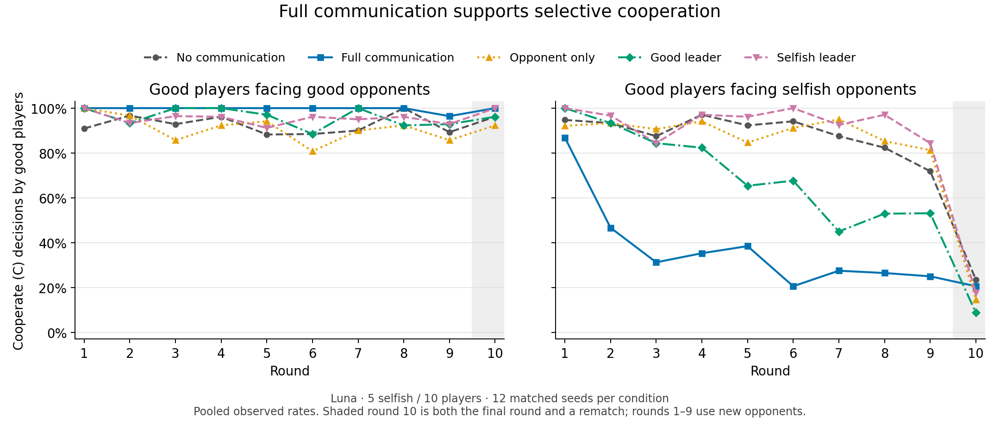

# Luna main study: five selfish players

Completed all **60 episodes, 3,000 encounters, and 12,600 accepted generation requests**.
The export validator passed all version-4 tables and cross-file consistency checks.
This cohort uses `openai/gpt-6-luna` through OpenRouter, medium reasoning, 10 players,
10 rounds, five communication conditions, and seeds 0–11. Each episode has exactly
five selfish players; players receive the hidden-count prior over 1, 3, and 5.

## Results

Each row averages 12 matched seeds. Payoff is per good-player encounter.
Cooperation columns condition on the opponent's actual observer-only role.

| Condition | Good-player payoff | Good C vs good | Good C vs selfish | Exploitation encounters |
|---|---:|---:|---:|---:|
| No communication | 1.3933 | 92.9% | 82.3% | 275 |
| Full communication | 1.7083 | 99.6% | 36.2% | 116 |
| Opponent only | 1.3850 | 91.0% | 82.3% | 275 |
| Good leader | 1.5067 | 95.9% | 65.0% | 217 |
| Selfish leader | 1.3850 | 95.5% | 86.5% | 289 |

Each condition contains 334 good–selfish encounters. Exploitation means the good
player chose C and the selfish opponent chose D. Full communication and a good
leader improved good-player payoff relative to no communication in all 12 seeds.
Selfish players defected in 2,991 of 3,000 decisions; all nine cooperative exceptions
occurred under full communication.



Rounds 1–9 introduce new opponents, while every round-10 encounter is a rematch.
The final-round effect and rematch effect therefore coincide. These results cover
the five-selfish-player cohort only; they do not pool the other computers' cohorts.

Opponent-only messages rarely shared named third-party encounter evidence: four
of 1,080 messages after round 1 contained a firsthand report about a named former
opponent other than the current recipient. This definition excludes self-history,
unnamed summaries, and discussion of the current recipient. All four reports agree
with the preceding encounter. See [verified examples](analysis/opponent_information_sharing.json).

## Browse the records

- [Canonical report](report.md), [aggregate metrics](analysis.json), and [episode scores](episodes.csv).
- [Actions](actions.csv), [messages](messages.csv), [leader assignments](leader_assignments.csv),
  [usage](usage.csv), and per-episode reports/checkpoints in [episodes/](episodes/).
- [Detailed encounter analysis](analysis/encounter_trends.json), [PDF figure](analysis/encounter_trends.pdf),
  and [reproducible analysis script](analysis/encounter_trends.py).
- [Final execution and validation receipt](execution.json), [publication verification](verification.json),
  and [file hashes and archive inventory](publication_manifest.json).

The reports contain observer information, including private messages, notes,
beliefs, and true roles. Agents received only their permitted private histories
and messages. Recorded strategy summaries are the requested brief outputs.

## Complete archive and restoration

[complete-run.tar.xz](complete-run.tar.xz) contains the complete run's original
files: all 12,600 request records, checkpoints, per-episode manifests, original
`visualization.json` and CSV/JSONL exports, frozen runtime and dependency lock,
execution receipts, and the recovery audit. It also contains launch scripts,
logs, and handoff records under `launch-records/`. Archive members retain their
original bytes; the publication manifest records each SHA-256 hash. Locks and
bytecode caches are omitted. Credentials and virtual environments are excluded.

From this published cohort directory:

```bash
mkdir -p restored
tar -xJf complete-run.tar.xz -C restored
```

The complete run appears at `restored/computer-3-luna-selfish-5/`. In an environment
with the project's locked dependencies installed, validate using its frozen runtime:

```bash
PYTHONPATH=restored/computer-3-luna-selfish-5/runtime \
  intentional-experiments validate-output restored/computer-3-luna-selfish-5
```

For visualization clients, use the restored `visualization.json` and
`visualization.schema.json`. The directly browsable files here are a convenient
subset; the archive restores the entire consistent export bundle. Reproduce the
supplementary figure with an environment containing matplotlib and numpy:

```bash
python analysis/encounter_trends.py \
  --run restored/computer-3-luna-selfish-5 --output reproduced-analysis
```

## Provenance and recovery

- Gameplay source: [`e75a825d12fb8b0e77f45f1e486fb02483455ea5`](https://github.com/shaowuz/intentional-agent/commit/e75a825d12fb8b0e77f45f1e486fb02483455ea5).
- Final scheduler: [`1b3626e5a2c152773a8f614932c3105bd03b7594`](https://github.com/shaowuz/intentional-agent/commit/1b3626e5a2c152773a8f614932c3105bd03b7594).
- Protocol: `rotating-v4`; export schema: `intentional-agent.visualization/4`.
- Run ID: `33edab7c-9408-4129-9d56-40082628ec8c`.
- Completion: November 7, 2026, 16:45 Pacific (November 8, 00:45 UTC).
- Provider-reported cost: **$9.617260625**, covering **12,630 saved model responses**
  including retries; every saved response includes cost metadata.

Concurrency increased through 5, 10, and 60 independent episodes while preserving
accepted records and the original runtime. A validation-only override allowed
six-decimal marginal-probability rounding at the upper bound. It recovered three
previously saved responses without new model calls or changes to actions,
strategies, or probabilities. [The override](validation_override.json), archived
original failed records, and recovery receipts document that change.

The archive also preserves earlier stopped-launch receipts, including the initial
supervisor's `completion.json`. The final run status comes from the top-level
`execution.json`, which reports all 60 episodes complete and exports valid.
