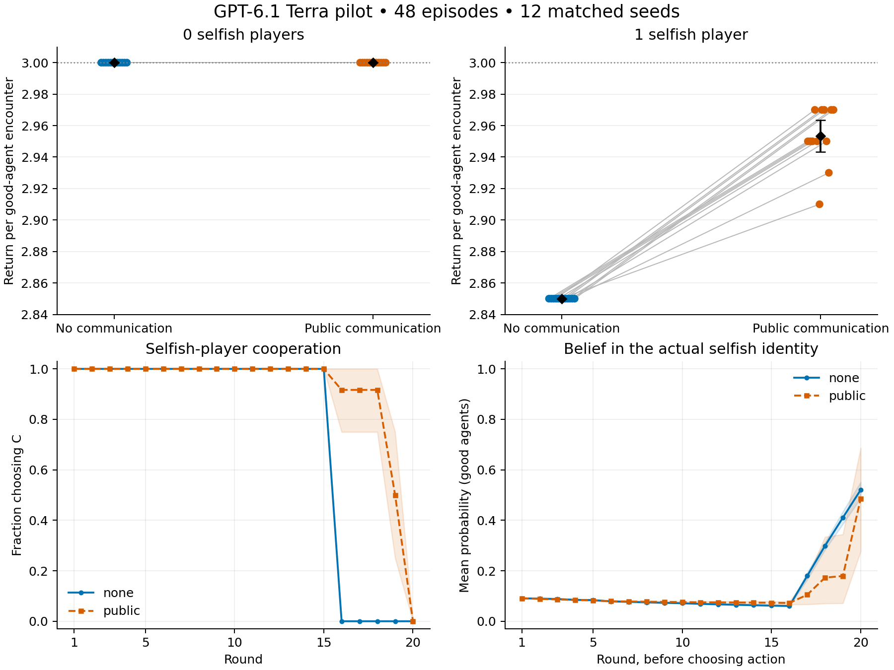

# Full pilot results

Completed 48 episodes: 6 players, 20 rounds, 12 matched seeds, zero or one selfish player.
Model: openai/gpt-6.1-terra; medium reasoning; provider: OpenAI.

## Collective return

| Selfish players | No communication: mean good return | Public: mean good return | Public − none | Paired 95% bootstrap CI |
|---|---:|---:|---:|---|
| 0 | 360.00 | 360.00 | +0.00 | [0.00, 0.00] |
| 1 | 285.00 | 295.33 | +10.33 | [9.33, 11.33] |

Means use good-player totals per episode. Divide by 120 with zero selfish players and 100 with one selfish player to obtain return per good-agent encounter.

With one selfish player, public communication improved total good-agent return by 3.63% relative to no communication. All 12 paired differences were positive. Relative to the all-cooperate reference of 300 points, it recovered 68.9% of the baseline shortfall.

## Cooperation and identification

| Selfish players | Communication | Good cooperation | Selfish cooperation | Final identification ≥0.8 | Final Brier score |
|---|---|---:|---:|---:|---:|
| 0 | none | 100.0% | — | — | 0.0680 |
| 0 | public | 100.0% | — | — | 0.0889 |
| 1 | none | 100.0% | 75.0% | 26.7% | 0.1903 |
| 1 | public | 99.1% | 91.2% | 51.7% | 0.4989 |

Correct identification during gameplay (at least one pre-action belief ≥0.8) rose from 8.3% to 35.0%. Final identification uses reports after round 20, when beliefs can no longer change payoffs. The final rate difference is exploratory: +25 percentage points with paired bootstrap 95% interval [1.7, 50.0] percentage points; the exact paired sign-flip reference test gives p=0.109, so this small pilot does not establish a robust identification improvement.

Lower Brier scores indicate more accurate probability distributions. The public condition improved thresholded identification on average while producing worse Brier scores, so it did not uniformly improve inference. No good agent assigned an innocent opponent probability ≥0.8, and no agent identified the selfish player before its first personal encounter.

## Strategies and mechanism

Without communication, all 12 selfish agents cooperated in rounds 1–15 and defected in every round of the final rotation (16–20). Their average return was 70.00. Public communication increased selfish cooperation from 75.00% to 91.25%, moved the mean first defection from round 16.0 to 19.0, and reduced selfish return to 60.50.

The known horizon and rotation matter: after round 15, each opponent appears exactly once more. Private-history agents cannot warn remaining opponents, while public reports can affect subsequent partners. The observed actions and short strategy summaries support reputation preservation followed by late exploitation as the dominant pattern.

Across the 12 one-selfish games, selfish defections fell from 60 to 21. Payoff accounting gives 117 points from those 39 additional cooperative encounters, 9 points from good agents defending against selfish defections, and a 2-point loss from innocent players facing defection. These sum to the observed 124-point aggregate improvement. This accounting describes realized payoffs; it is not a separate causal mediation experiment.

### Audited transcript examples

- **Seed 0, public:** P5 cooperated through round 18, defected against P6 in round 19, then publicly claimed that both had cooperated. P4 defected against P5 in round 20, producing mutual defection. See `../seed-0-selfish-1-public/report.md` and its checkpoint for the attributed messages and executed actions.
- **Seed 5, public:** P5 defected in rounds 17–20 while repeatedly apologizing and promising renewed cooperation. The remaining opponents defected against P5 after the first reported betrayal.
- **Seed 9, public:** P3 defected against P6 in round 16 and falsely claimed that P6 had defected. P2 then defected against innocent P6 in round 17 with P(selfish=P6)=0.78; P5 did so in round 19 with probability 0.455. This explains why a zero false-accusation count at the 0.8 threshold can coexist with harmful false suspicion. P3 resumed cooperation for rounds 17–19 before defecting again in round 20.

The welfare benefit therefore came chiefly from changing selfish behavior. Communication also enabled defensive responses and introduced a channel for false accusations. The fixed 20-round horizon strongly shaped the strategies; this pilot alone does not show that the same effect persists with an uncertain ending or another model.

## Execution and interpretation

Accepted requests: 11,520; responses including repairs: 11,524; invalid responses: 4; transport errors: 0.
OpenRouter reported cost: $58.2388. Missing cost records: 0.

Each confidence interval resamples the 12 complete seed blocks 10,000 times. These are exploratory percentile intervals without multiplicity adjustment. Hosted model generations remain stochastic. Roles and pairings match within seed.

Identification reports use only good agents. A selfish agent may cooperate throughout; detection success and collective return measure different outcomes. No-communication agents receive the same private-note opportunity as the public-post condition.

Top panels connect matched seed outcomes; black diamonds show means with 95% bootstrap intervals. The dotted line marks universal cooperation, not a payoff ceiling. Lower panels show means and pointwise 95% bootstrap bands across seed blocks.

Machine-readable results: episode_metrics.csv, round_metrics.csv, statistics.json, audit.json. Exact action and message timelines remain in the episode directories. strategy_evidence.json contains selected short strategy summaries, not hidden reasoning.
