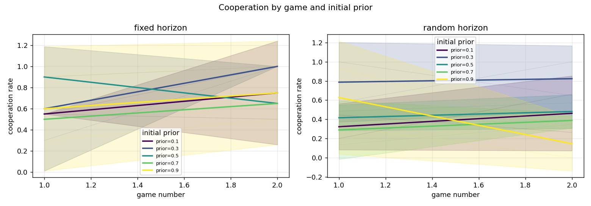
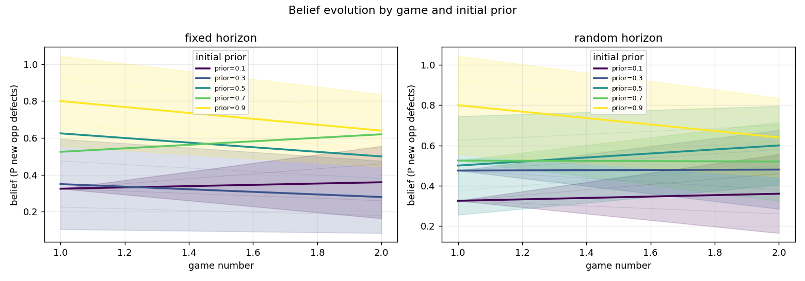
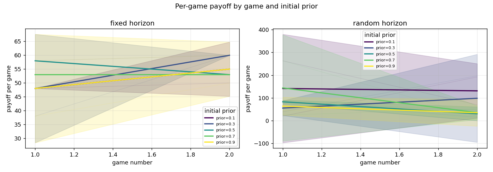
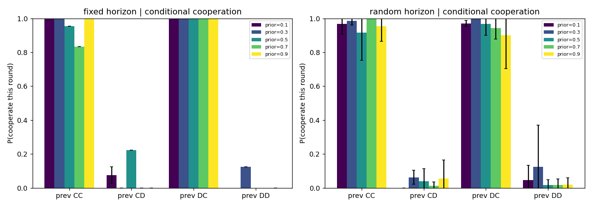
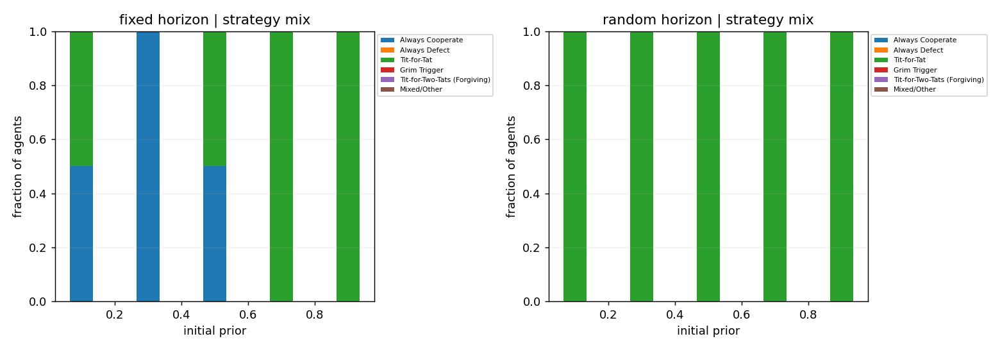
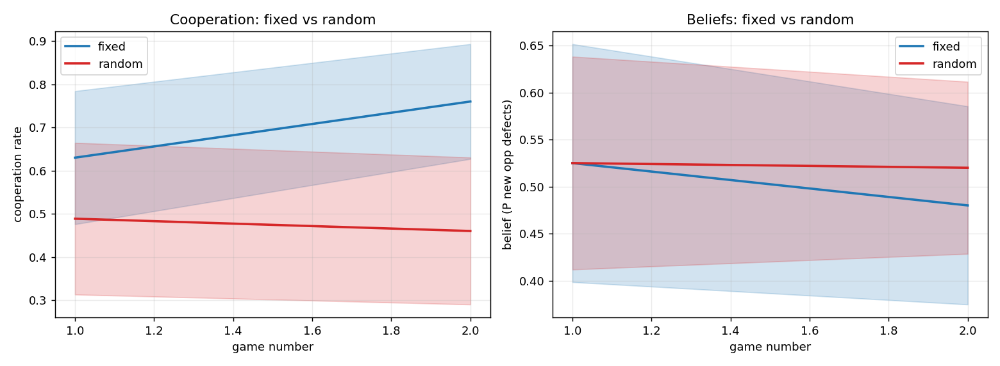

# Iterated Prisoner's Dilemma LLM experiment - research report

_Generated: 2026-11-07 11:45:08_

## Data provenance

```
               field               value
          experiment               pilot
                seed            20240501
        llm_provider                mock
           llm_model      mock-strategic
agents_per_condition                  10
     games_per_agent                   2
        fixed_rounds                  20
       continue_prob                0.95
          started_at 2026-11-07T11:44:00
```

> **IMPORTANT - MOCK BACKEND.** These results were produced with the offline `mock` backend. They validate the pipeline (memory, simultaneous play, recording, analysis) and are **not** scientific findings about LLM behaviour. Re-run with a real model to obtain substantive results.

## 1. Cooperation by prior group and game

```
condition  n_agents  mean_coop_rate  mean_game_payoff  mean_belief  mean_actual_rounds  max_actual_rounds  capped_games
    fixed        10        0.695000             53.10       0.5025                20.0                 20             0
   random        10        0.474488             81.85       0.5225                37.0                119             0
```



## 2. Evolution of agents' estimated beliefs

```
condition prior_group  mean      std  count
    fixed         0.1  0.36 0.141421      2
    fixed         0.3  0.28 0.141421      2
    fixed         0.5  0.50 0.000000      2
    fixed         0.7  0.62 0.000000      2
    fixed         0.9  0.64 0.141421      2
   random         0.1  0.36 0.141421      2
   random         0.3  0.48 0.141421      2
   random         0.5  0.60 0.141421      2
   random         0.7  0.52 0.141421      2
   random         0.9  0.64 0.141421      2
```



## 3. Payoffs

Per-game and cumulative payoff figures are in `figures/payoff_by_game.png` and `figures/cumulative_payoff_by_game.png`.



## 4. Conditional cooperation (P(cooperate | previous outcome))

```
condition prior_group       CC       CD       DC       DD
    fixed         0.1 1.000000 0.075000 1.000000      NaN
    fixed         0.3 1.000000 0.000000 1.000000 0.125000
    fixed         0.5 0.954545 0.222222 1.000000      NaN
    fixed         0.7 0.833333 0.000000 1.000000      NaN
    fixed         0.9 1.000000 0.000000 1.000000 0.000000
   random         0.1 0.968750 0.000000 0.969362 0.045455
   random         0.3 0.986486 0.062500 1.000000 0.125000
   random         0.5 0.916667 0.038462 0.966667 0.016129
   random         0.7 1.000000 0.012195 0.942350 0.017857
   random         0.9 0.954545 0.055556 0.900000 0.020000
```



## 5. Emergence of recognizable strategies

```
condition         strategy  n_agents
    fixed Always Cooperate         4
    fixed      Tit-for-Tat         6
   random      Tit-for-Tat        10
```



Strategies are classified by a transparent heuristic: each candidate (AllC, AllD, Tit-for-Tat, Grim Trigger, Tit-for-Two-Tats) is scored by the fraction of rounds in which its predicted action matches the observed action, and the best match above 0.75 is reported; otherwise `Mixed/Other`. This is descriptive and does not claim to read the model's internal algorithm.

## 6. Do different priors converge?

```
condition  group_mean_min  group_mean_max  between_group_range  pooled_mean  pooled_std
    fixed            0.28            0.64                 0.36         0.48    0.169967
   random            0.36            0.64                 0.28         0.52    0.147573
```

A small `between_group_range` in final beliefs indicates convergence across prior groups; a large range indicates that initial priors persist.

## 7. Fixed vs random horizon

```
condition  n_agents  mean_coop_rate  mean_game_payoff  mean_belief  mean_actual_rounds  max_actual_rounds  capped_games
    fixed        10        0.695000             53.10       0.5025                20.0                 20             0
   random        10        0.474488             81.85       0.5225                37.0                119             0
```



## 8. Uncertainty, independence and limitations

- Error bars are 95% confidence intervals of the mean across agents within a prior group (normal approximation to the SEM). They reflect variability among agents in this run, not sampling error over independent repetitions of the whole experiment.
- Agents are repeatedly paired and interact, so observations across agents are **not independent**. CIs and comparisons are descriptive, not formal hypothesis tests.
- This is a **single run**. Any inferential claim requires repeating the entire experiment across multiple independent seeds (and ideally multiple model families) and analysing seed-level results.
- No statistical significance is claimed anywhere in this report.

## Figures

- `figures/cooperation_by_game.png`
- `figures/belief_by_game.png`
- `figures/payoff_by_game.png`
- `figures/cumulative_payoff_by_game.png`
- `figures/conditional_cooperation.png`
- `figures/strategy_distribution.png`
- `figures/final_beliefs.png`
- `figures/horizon_comparison.png`
