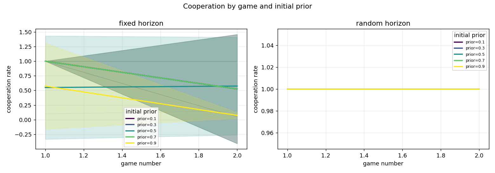
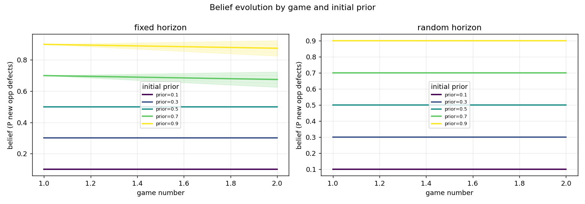
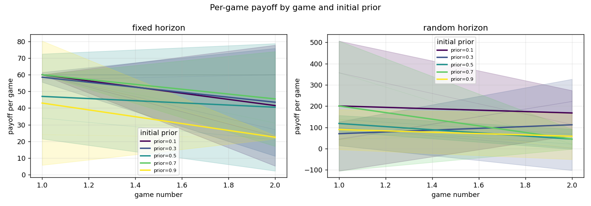
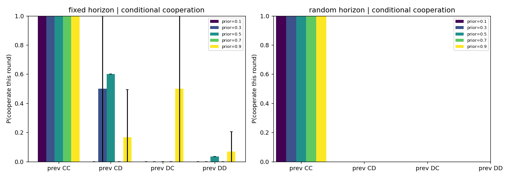
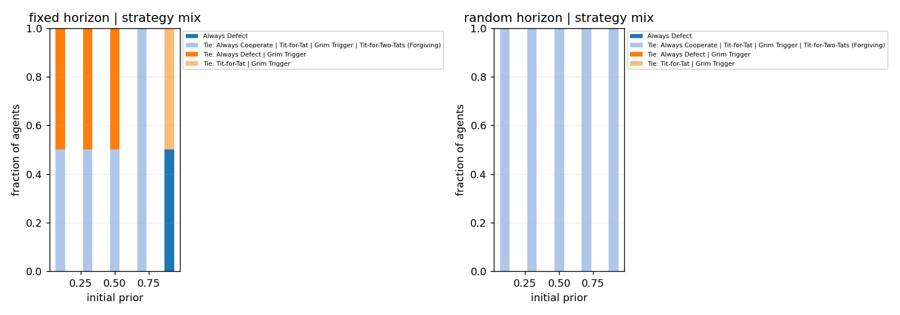
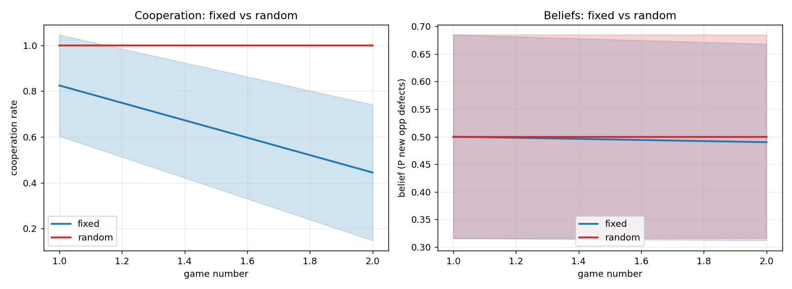

# Iterated Prisoner's Dilemma LLM experiment - research report

_Generated: 2026-11-07 12:15:49_

## Data provenance

```
               field               value
          experiment               pilot
                seed            20240501
        llm_provider              openai
           llm_model  openai/gpt-4o-mini
agents_per_condition                  10
     games_per_agent                   2
        fixed_rounds                  20
       continue_prob                0.95
          started_at 2026-11-07T11:49:40
```

## 1. Cooperation by prior group and game

```
condition  n_agents  mean_coop_rate  mean_game_payoff  mean_belief  mean_actual_rounds  max_actual_rounds  capped_games
    fixed        10           0.635              46.2        0.495                20.0                 20             0
   random        10           1.000             111.0        0.500                37.0                119             0
```



## 2. Evolution of agents' estimated beliefs

```
condition prior_group  mean      std  count
    fixed         0.1 0.100 0.000000      2
    fixed         0.3 0.300 0.000000      2
    fixed         0.5 0.500 0.000000      2
    fixed         0.7 0.675 0.035355      2
    fixed         0.9 0.875 0.035355      2
   random         0.1 0.100 0.000000      2
   random         0.3 0.300 0.000000      2
   random         0.5 0.500 0.000000      2
   random         0.7 0.700 0.000000      2
   random         0.9 0.900 0.000000      2
```



## 3. Payoffs

Per-game and cumulative payoff figures are in `figures/payoff_by_game.png` and `figures/cumulative_payoff_by_game.png`.



## 4. Conditional cooperation (P(cooperate | previous outcome))

```
condition prior_group  CC       CD  DC       DD
    fixed         0.1 1.0 0.000000 0.0 0.000000
    fixed         0.3 1.0 0.500000 0.0 0.000000
    fixed         0.5 1.0 0.600000 0.0 0.035714
    fixed         0.7 1.0 0.000000 0.0 0.000000
    fixed         0.9 1.0 0.166667 0.5 0.068966
   random         0.1 1.0      NaN NaN      NaN
   random         0.3 1.0      NaN NaN      NaN
   random         0.5 1.0      NaN NaN      NaN
   random         0.7 1.0      NaN NaN      NaN
   random         0.9 1.0      NaN NaN      NaN
```



## 5. Emergence of recognizable strategies

```
condition                                                                          strategy  n_agents
    fixed                                                                     Always Defect         1
    fixed Tie: Always Cooperate | Tit-for-Tat | Grim Trigger | Tit-for-Two-Tats (Forgiving)         5
    fixed                                                 Tie: Always Defect | Grim Trigger         3
    fixed                                                   Tie: Tit-for-Tat | Grim Trigger         1
   random Tie: Always Cooperate | Tit-for-Tat | Grim Trigger | Tit-for-Two-Tats (Forgiving)        10
```



Strategies are classified by a transparent heuristic: each candidate (AllC, AllD, Tit-for-Tat, Grim Trigger, Tit-for-Two-Tats) is scored by the fraction of rounds in which its predicted action matches the observed action. If the best score is below 0.75 the label is `Mixed/Other`. If several strategies tie, the label is reported as `Tie: A | B | ...` because the action sequence cannot distinguish them (e.g. when the opponent never defects, Always Cooperate, Tit-for-Tat, Grim Trigger and Tit-for-Two-Tats make identical predictions). This is descriptive and does not claim to read the model's internal algorithm.

## 6. Do different priors converge?

```
condition  group_mean_min  group_mean_max  between_group_range  pooled_mean  pooled_std
    fixed             0.1           0.875                0.775         0.49    0.287518
   random             0.1           0.900                0.800         0.50    0.298142
```

A small `between_group_range` in final beliefs indicates convergence across prior groups; a large range indicates that initial priors persist.

## 7. Fixed vs random horizon

```
condition  n_agents  mean_coop_rate  mean_game_payoff  mean_belief  mean_actual_rounds  max_actual_rounds  capped_games
    fixed        10           0.635              46.2        0.495                20.0                 20             0
   random        10           1.000             111.0        0.500                37.0                119             0
```



## 8. Uncertainty, independence and limitations

- Error bars are 95% confidence intervals of the mean across agents within a prior group (normal approximation to the SEM). They reflect variability among agents in this run, not sampling error over independent repetitions of the whole experiment.
- Agents are repeatedly paired and interact, so observations across agents are **not independent**. CIs and comparisons are descriptive, not formal hypothesis tests.
- This is a **single run**. Any inferential claim requires repeating the entire experiment across multiple independent seeds (and ideally multiple model families) and analysing seed-level results.
- No statistical significance is claimed anywhere in this report.

## Figures

- `figures/cooperation_by_game.png`
- `figures/belief_by_game.png`
- `figures/payoff_by_game.png`
- `figures/cumulative_payoff_by_game.png`
- `figures/conditional_cooperation.png`
- `figures/strategy_distribution.png`
- `figures/final_beliefs.png`
- `figures/horizon_comparison.png`
