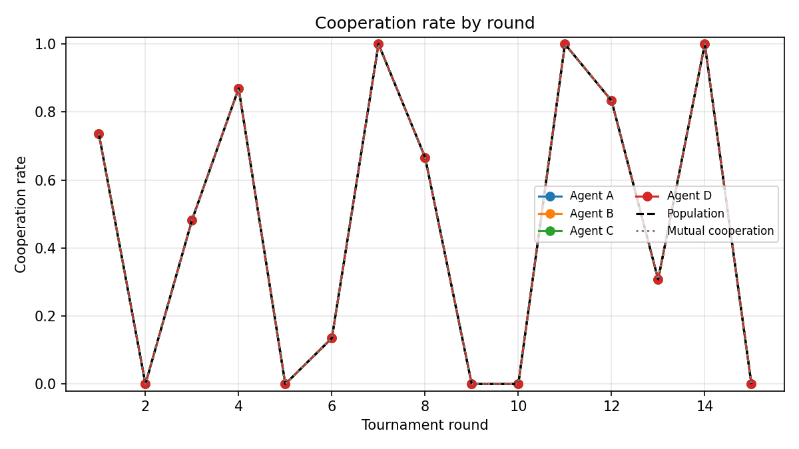
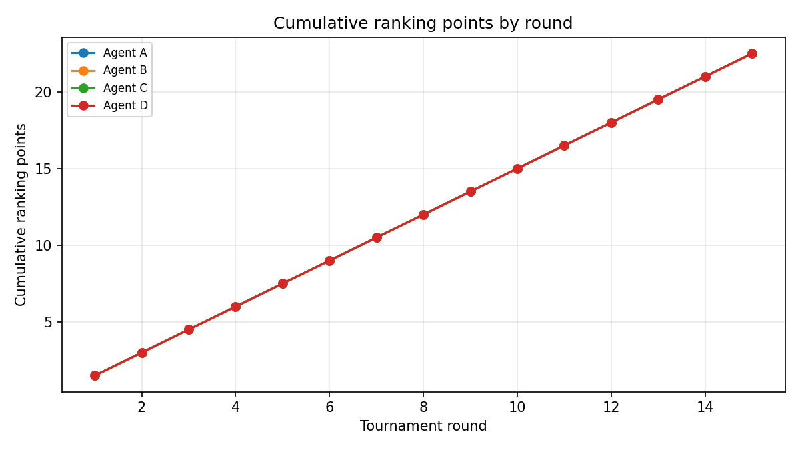
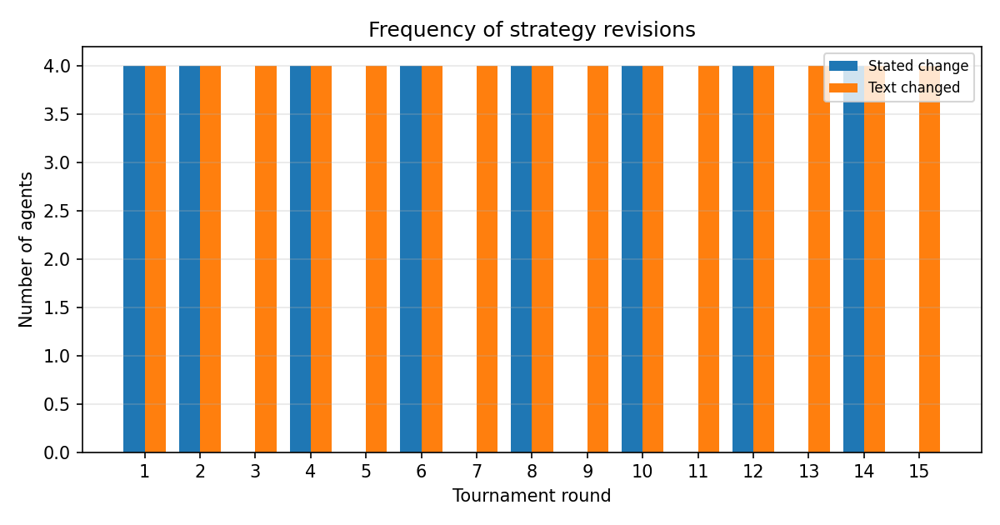
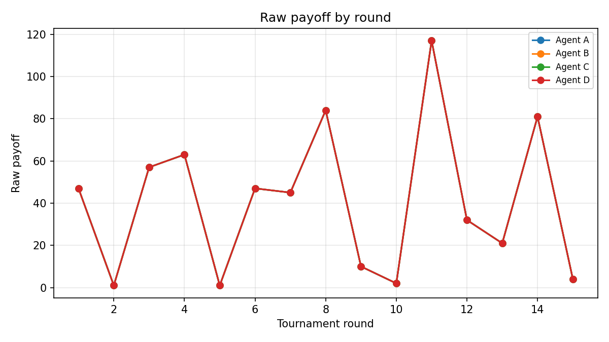
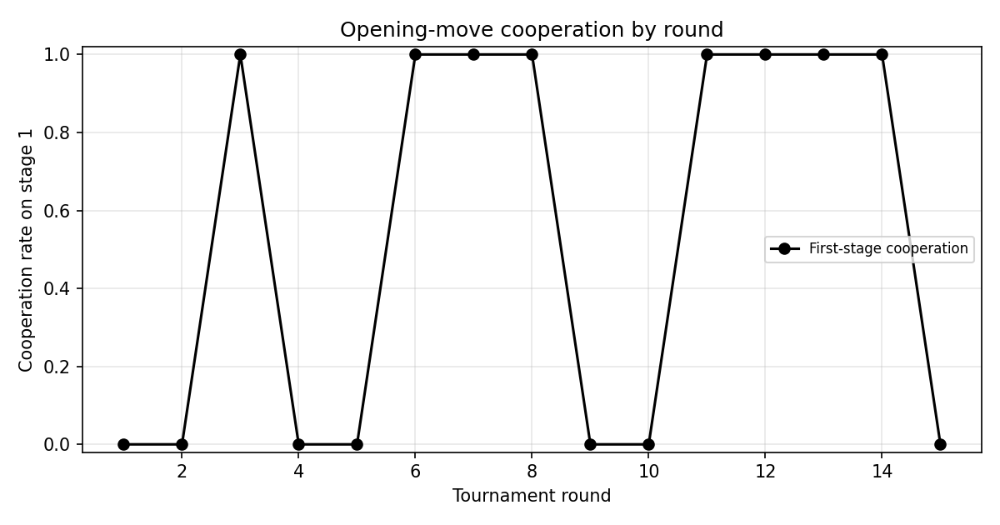

# Emergent Strategies in a 4-Agent Prisoner's Dilemma Tournament

## Execution status

- **Run status:** `completed`
- **Mode:** `mock`
- **Provider / model:** `mock` / `mock-ranked`
- **Random seed:** `20240501`
- **Tournament:** 15 rounds, agents A, B, C, D
- **Continuation probability:** 0.95
- **Output directory:** `results/ranked_tournament_mock`
- **Started:** 2026-11-07T23:02:27.246161+00:00
- **Finished:** 2026-11-07T23:02:27.620225+00:00
- **API usage:** 1132 calls, 1,951,424 input tokens, 27,960 output tokens, estimated cost $0.000000
  - pricing not configured: estimated_cost_usd=0 is NOT a true cost. Set llm.pricing.* or pass --price-in/--price-out, or compute afterwards with scripts/report_usage.py.

> **IMPORTANT:** This report was generated with the deterministic offline mock backend. It validates the pipeline only and is **not** evidence about LLM behaviour.

## Experiment design

- Four persistent agents (A, B, C, D) used the same model, temperature, initial instructions and decision rules.
- Each round contained two simultaneous pair-games. Pairings were sampled independently each round from the seeded RNG; repeat encounters were allowed. Opponent identities were never shown to agents.
- Both games in a round used the same hidden geometric length (continuation probability 0.95).
- After both games, the four agents were ranked by raw payoff in that round and received 3, 2, 1 or 0 points, with ties averaged. Each round was an independent objective.
- After every round, including the last, each agent produced a structured private reflection and could keep or revise its strategy.

## Table 1: Tournament Results

Each cell is `raw payoff (ranking points)`. The last two columns give total ranking points across the tournament and the agent's overall cooperation rate.

| Agent | R1 | R2 | R3 | R4 | R5 | R6 | R7 | R8 | R9 | R10 | R11 | R12 | R13 | R14 | R15 | Total points | Overall coop rate |
|---|---|---|---|---|---|---|---|---|---|---|---|---|---|---|---|---|---|
| Agent A | 47 (1.5) | 1 (1.5) | 57 (1.5) | 63 (1.5) | 1 (1.5) | 47 (1.5) | 45 (1.5) | 84 (1.5) | 10 (1.5) | 2 (1.5) | 117 (1.5) | 32 (1.5) | 21 (1.5) | 81 (1.5) | 4 (1.5) | 22.5 | 64% |
| Agent B | 47 (1.5) | 1 (1.5) | 57 (1.5) | 63 (1.5) | 1 (1.5) | 47 (1.5) | 45 (1.5) | 84 (1.5) | 10 (1.5) | 2 (1.5) | 117 (1.5) | 32 (1.5) | 21 (1.5) | 81 (1.5) | 4 (1.5) | 22.5 | 64% |
| Agent C | 47 (1.5) | 1 (1.5) | 57 (1.5) | 63 (1.5) | 1 (1.5) | 47 (1.5) | 45 (1.5) | 84 (1.5) | 10 (1.5) | 2 (1.5) | 117 (1.5) | 32 (1.5) | 21 (1.5) | 81 (1.5) | 4 (1.5) | 22.5 | 64% |
| Agent D | 47 (1.5) | 1 (1.5) | 57 (1.5) | 63 (1.5) | 1 (1.5) | 47 (1.5) | 45 (1.5) | 84 (1.5) | 10 (1.5) | 2 (1.5) | 117 (1.5) | 32 (1.5) | 21 (1.5) | 81 (1.5) | 4 (1.5) | 22.5 | 64% |

Population overall cooperation rate: 64%. Mutual cooperation rate: 64%.

## Table 2: Strategy Evolution

The table lists each agent's stated strategy after every round, whether the agent said it was changing strategy, and its reason. Even when `Changed?` is `no`, `strategy_after` is the strategy the agent said it would use next round.

| Agent | Round | Changed? | Strategy after round | Reason |
|---|---|---|---|---|
| A | 1 | yes | Mock strategy: mirror the opponent's previous action with occasional exploration (updated after round 1). | Mock reflection for pipeline validation; no scientific meaning. |
| B | 1 | yes | Mock strategy: mirror the opponent's previous action with occasional exploration (updated after round 1). | Mock reflection for pipeline validation; no scientific meaning. |
| C | 1 | yes | Mock strategy: mirror the opponent's previous action with occasional exploration (updated after round 1). | Mock reflection for pipeline validation; no scientific meaning. |
| D | 1 | yes | Mock strategy: mirror the opponent's previous action with occasional exploration (updated after round 1). | Mock reflection for pipeline validation; no scientific meaning. |
| A | 2 | yes | Mock strategy: mirror the opponent's previous action with occasional exploration (updated after round 2). | Mock reflection for pipeline validation; no scientific meaning. |
| B | 2 | yes | Mock strategy: mirror the opponent's previous action with occasional exploration (updated after round 2). | Mock reflection for pipeline validation; no scientific meaning. |
| C | 2 | yes | Mock strategy: mirror the opponent's previous action with occasional exploration (updated after round 2). | Mock reflection for pipeline validation; no scientific meaning. |
| D | 2 | yes | Mock strategy: mirror the opponent's previous action with occasional exploration (updated after round 2). | Mock reflection for pipeline validation; no scientific meaning. |
| A | 3 | no | Mock strategy: mirror the opponent's previous action with occasional exploration (updated after round 3). | Mock reflection for pipeline validation; no scientific meaning. |
| B | 3 | no | Mock strategy: mirror the opponent's previous action with occasional exploration (updated after round 3). | Mock reflection for pipeline validation; no scientific meaning. |
| C | 3 | no | Mock strategy: mirror the opponent's previous action with occasional exploration (updated after round 3). | Mock reflection for pipeline validation; no scientific meaning. |
| D | 3 | no | Mock strategy: mirror the opponent's previous action with occasional exploration (updated after round 3). | Mock reflection for pipeline validation; no scientific meaning. |
| A | 4 | yes | Mock strategy: mirror the opponent's previous action with occasional exploration (updated after round 4). | Mock reflection for pipeline validation; no scientific meaning. |
| B | 4 | yes | Mock strategy: mirror the opponent's previous action with occasional exploration (updated after round 4). | Mock reflection for pipeline validation; no scientific meaning. |
| C | 4 | yes | Mock strategy: mirror the opponent's previous action with occasional exploration (updated after round 4). | Mock reflection for pipeline validation; no scientific meaning. |
| D | 4 | yes | Mock strategy: mirror the opponent's previous action with occasional exploration (updated after round 4). | Mock reflection for pipeline validation; no scientific meaning. |
| A | 5 | no | Mock strategy: mirror the opponent's previous action with occasional exploration (updated after round 5). | Mock reflection for pipeline validation; no scientific meaning. |
| B | 5 | no | Mock strategy: mirror the opponent's previous action with occasional exploration (updated after round 5). | Mock reflection for pipeline validation; no scientific meaning. |
| C | 5 | no | Mock strategy: mirror the opponent's previous action with occasional exploration (updated after round 5). | Mock reflection for pipeline validation; no scientific meaning. |
| D | 5 | no | Mock strategy: mirror the opponent's previous action with occasional exploration (updated after round 5). | Mock reflection for pipeline validation; no scientific meaning. |
| A | 6 | yes | Mock strategy: mirror the opponent's previous action with occasional exploration (updated after round 6). | Mock reflection for pipeline validation; no scientific meaning. |
| B | 6 | yes | Mock strategy: mirror the opponent's previous action with occasional exploration (updated after round 6). | Mock reflection for pipeline validation; no scientific meaning. |
| C | 6 | yes | Mock strategy: mirror the opponent's previous action with occasional exploration (updated after round 6). | Mock reflection for pipeline validation; no scientific meaning. |
| D | 6 | yes | Mock strategy: mirror the opponent's previous action with occasional exploration (updated after round 6). | Mock reflection for pipeline validation; no scientific meaning. |
| A | 7 | no | Mock strategy: mirror the opponent's previous action with occasional exploration (updated after round 7). | Mock reflection for pipeline validation; no scientific meaning. |
| B | 7 | no | Mock strategy: mirror the opponent's previous action with occasional exploration (updated after round 7). | Mock reflection for pipeline validation; no scientific meaning. |
| C | 7 | no | Mock strategy: mirror the opponent's previous action with occasional exploration (updated after round 7). | Mock reflection for pipeline validation; no scientific meaning. |
| D | 7 | no | Mock strategy: mirror the opponent's previous action with occasional exploration (updated after round 7). | Mock reflection for pipeline validation; no scientific meaning. |
| A | 8 | yes | Mock strategy: mirror the opponent's previous action with occasional exploration (updated after round 8). | Mock reflection for pipeline validation; no scientific meaning. |
| B | 8 | yes | Mock strategy: mirror the opponent's previous action with occasional exploration (updated after round 8). | Mock reflection for pipeline validation; no scientific meaning. |
| C | 8 | yes | Mock strategy: mirror the opponent's previous action with occasional exploration (updated after round 8). | Mock reflection for pipeline validation; no scientific meaning. |
| D | 8 | yes | Mock strategy: mirror the opponent's previous action with occasional exploration (updated after round 8). | Mock reflection for pipeline validation; no scientific meaning. |
| A | 9 | no | Mock strategy: mirror the opponent's previous action with occasional exploration (updated after round 9). | Mock reflection for pipeline validation; no scientific meaning. |
| B | 9 | no | Mock strategy: mirror the opponent's previous action with occasional exploration (updated after round 9). | Mock reflection for pipeline validation; no scientific meaning. |
| C | 9 | no | Mock strategy: mirror the opponent's previous action with occasional exploration (updated after round 9). | Mock reflection for pipeline validation; no scientific meaning. |
| D | 9 | no | Mock strategy: mirror the opponent's previous action with occasional exploration (updated after round 9). | Mock reflection for pipeline validation; no scientific meaning. |
| A | 10 | yes | Mock strategy: mirror the opponent's previous action with occasional exploration (updated after round 10). | Mock reflection for pipeline validation; no scientific meaning. |
| B | 10 | yes | Mock strategy: mirror the opponent's previous action with occasional exploration (updated after round 10). | Mock reflection for pipeline validation; no scientific meaning. |
| C | 10 | yes | Mock strategy: mirror the opponent's previous action with occasional exploration (updated after round 10). | Mock reflection for pipeline validation; no scientific meaning. |
| D | 10 | yes | Mock strategy: mirror the opponent's previous action with occasional exploration (updated after round 10). | Mock reflection for pipeline validation; no scientific meaning. |
| A | 11 | no | Mock strategy: mirror the opponent's previous action with occasional exploration (updated after round 11). | Mock reflection for pipeline validation; no scientific meaning. |
| B | 11 | no | Mock strategy: mirror the opponent's previous action with occasional exploration (updated after round 11). | Mock reflection for pipeline validation; no scientific meaning. |
| C | 11 | no | Mock strategy: mirror the opponent's previous action with occasional exploration (updated after round 11). | Mock reflection for pipeline validation; no scientific meaning. |
| D | 11 | no | Mock strategy: mirror the opponent's previous action with occasional exploration (updated after round 11). | Mock reflection for pipeline validation; no scientific meaning. |
| A | 12 | yes | Mock strategy: mirror the opponent's previous action with occasional exploration (updated after round 12). | Mock reflection for pipeline validation; no scientific meaning. |
| B | 12 | yes | Mock strategy: mirror the opponent's previous action with occasional exploration (updated after round 12). | Mock reflection for pipeline validation; no scientific meaning. |
| C | 12 | yes | Mock strategy: mirror the opponent's previous action with occasional exploration (updated after round 12). | Mock reflection for pipeline validation; no scientific meaning. |
| D | 12 | yes | Mock strategy: mirror the opponent's previous action with occasional exploration (updated after round 12). | Mock reflection for pipeline validation; no scientific meaning. |
| A | 13 | no | Mock strategy: mirror the opponent's previous action with occasional exploration (updated after round 13). | Mock reflection for pipeline validation; no scientific meaning. |
| B | 13 | no | Mock strategy: mirror the opponent's previous action with occasional exploration (updated after round 13). | Mock reflection for pipeline validation; no scientific meaning. |
| C | 13 | no | Mock strategy: mirror the opponent's previous action with occasional exploration (updated after round 13). | Mock reflection for pipeline validation; no scientific meaning. |
| D | 13 | no | Mock strategy: mirror the opponent's previous action with occasional exploration (updated after round 13). | Mock reflection for pipeline validation; no scientific meaning. |
| A | 14 | yes | Mock strategy: mirror the opponent's previous action with occasional exploration (updated after round 14). | Mock reflection for pipeline validation; no scientific meaning. |
| B | 14 | yes | Mock strategy: mirror the opponent's previous action with occasional exploration (updated after round 14). | Mock reflection for pipeline validation; no scientific meaning. |
| C | 14 | yes | Mock strategy: mirror the opponent's previous action with occasional exploration (updated after round 14). | Mock reflection for pipeline validation; no scientific meaning. |
| D | 14 | yes | Mock strategy: mirror the opponent's previous action with occasional exploration (updated after round 14). | Mock reflection for pipeline validation; no scientific meaning. |
| A | 15 | no | Mock strategy: mirror the opponent's previous action with occasional exploration (updated after round 15). | Mock reflection for pipeline validation; no scientific meaning. |
| B | 15 | no | Mock strategy: mirror the opponent's previous action with occasional exploration (updated after round 15). | Mock reflection for pipeline validation; no scientific meaning. |
| C | 15 | no | Mock strategy: mirror the opponent's previous action with occasional exploration (updated after round 15). | Mock reflection for pipeline validation; no scientific meaning. |
| D | 15 | no | Mock strategy: mirror the opponent's previous action with occasional exploration (updated after round 15). | Mock reflection for pipeline validation; no scientific meaning. |

## Figures











## Qualitative Analysis

### 1. Did agents develop distinct strategies despite identical initial conditions?

The final strategy descriptions were textually identical. This does not prove the behaviour was identical; compare the action and cooperation statistics below.

- **Agent A:** cooperation rate 64%. Final strategy: Mock strategy: mirror the opponent's previous action with occasional exploration (updated after round 15).
- **Agent B:** cooperation rate 64%. Final strategy: Mock strategy: mirror the opponent's previous action with occasional exploration (updated after round 15).
- **Agent C:** cooperation rate 64%. Final strategy: Mock strategy: mirror the opponent's previous action with occasional exploration (updated after round 15).
- **Agent D:** cooperation rate 64%. Final strategy: Mock strategy: mirror the opponent's previous action with occasional exploration (updated after round 15).

### 2. Did cooperation increase or decrease over time?

Population cooperation averaged 46% in the first half of the tournament and 48% in the second half (change +0.02). Mutual cooperation averaged 46% and 48% respectively.

**Observation:** there was no large first-half/second-half change in this run; round-to-round variation may still be substantial.

### 3. Did agents discover reciprocity or retaliation?

The table reports, within pair-games, the probability that an agent cooperated on the stage after its opponent cooperated (`P(C|opp C)`) and after its opponent defected (`P(C|opp D)`). A positive difference is consistent with conditional cooperation; a low `P(C|opp D)` is consistent with retaliation.

| Agent | P(C | opp C) | P(C | opp D) | Difference | n after C | n after D |
|---|---|---|---|---|---|
| Agent A | 95% | 7% | +0.88 | 166 | 87 |
| Agent B | 95% | 7% | +0.88 | 166 | 87 |
| Agent C | 95% | 7% | +0.88 | 166 | 87 |
| Agent D | 95% | 7% | +0.88 | 166 | 87 |

**Observation:** the pooled difference is +0.88, consistent with reciprocal/conditional cooperation. This is a behavioural pattern, not proof that agents formed an explicit reciprocity rule.

### 4. Were strategy revisions associated with improved subsequent performance?

After a stated strategy change, agents averaged 1.50 ranking points in the next round (n=32 agent-round observations). After no stated change, they averaged 1.50 points (n=24). Mean next-round raw payoffs were 32.00 and 51.50 respectively.

**Observation:** this is descriptive. Agents choose when to revise, rounds differ in opponent and game length, and observations are not independent. A difference here does **not** establish that reflection caused the subsequent performance.

### 5. Did agents adapt to the anonymous population rather than individual opponents?

First-stage cooperation averaged 43% in the first half and 62% in the second half (change +0.20).

Agents never received opponent identities and each saw only its own history. A change in opening behaviour is therefore consistent with learning about the anonymous population as a whole rather than about a named individual. It is not conclusive: within-game experience, model drift, and round composition can also move this statistic.

- Agent A: first-stage cooperation 53%
- Agent B: first-stage cooperation 53%
- Agent C: first-stage cooperation 53%
- Agent D: first-stage cooperation 53%

### 6. Did some agents develop strategies inconsistent with their stated objectives?

No keyword-level inconsistencies were detected between the final strategy text and observed behaviour. This check is deliberately simple: strategies can be complex, and a strategy may be consistent with the current-round ranking objective without using words such as 'cooperate' or 'defect'.

### Observations versus causal conclusions

Everything above is descriptive. Agents interact, pairings repeat, and one tournament is a single realisation. The experiment cannot establish that reflection caused any improvement, that a particular strategy is optimal, or that the observed cooperation trend would generalise to other seeds or models. Independent replications across seeds (and ideally model families) are required for inferential claims.

## Limitations

- Single tournament realisation; no independent replications across seeds or models.
- Agents are repeatedly paired, so stage-level observations are not independent.
- The ranking objective is relative: an agent's points depend on the other three agents' payoffs in that round, not only on its own cooperation.
- The strategy-consistency checks are transparent keyword heuristics, not a reading of the model's internal computation.
- **This run used the offline mock backend.** Its outputs are synthetic and must not be interpreted as LLM behaviour.

## Files

- `pairings.jsonl`
- `stages.jsonl`
- `games.jsonl`
- `rounds.jsonl`
- `reflections.jsonl`
- `strategies.jsonl`
- `usage.jsonl`
- `calls.jsonl`
- `checkpoint.json`
- `experiment_meta.json`
- `run_status.json`
- `config_snapshot.yaml`
- `tables/` (Table 1/2 CSV and Markdown, cooperation by round)
- `figures/` (cooperation, cumulative points, revisions)

Reproduction command (after setting `OPENAI_API_KEY`):

```bash
python3 -m ranked_tournament.cli run --config config/ranked_tournament.yaml
python3 -m ranked_tournament.cli analyze --results results/ranked_tournament_mock
```
