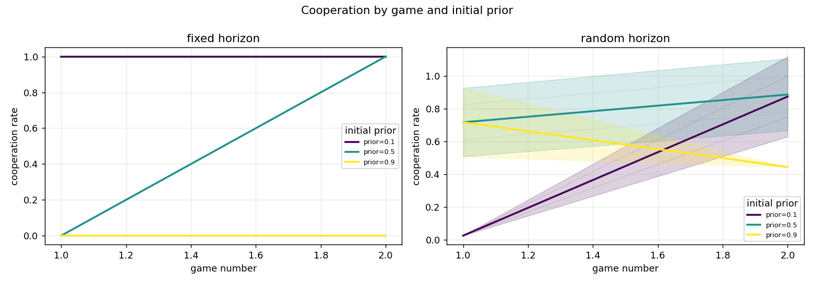
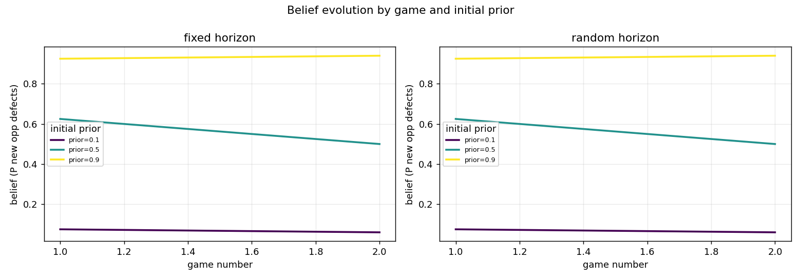
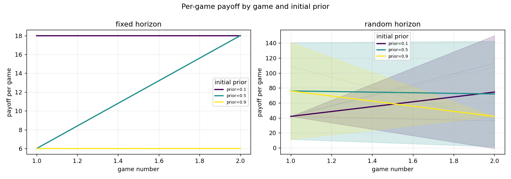
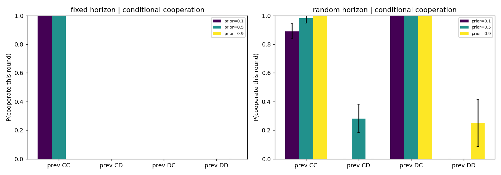
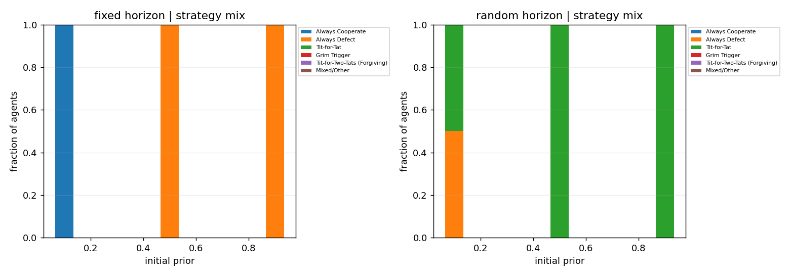
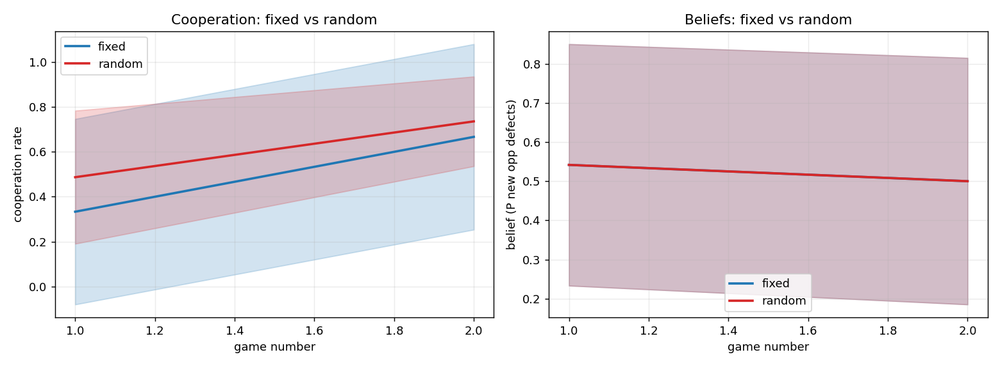

# Iterated Prisoner's Dilemma LLM experiment - research report

_Generated: 2026-11-07 11:45:09_

## Data provenance

```
               field               value
          experiment               smoke
                seed               12345
        llm_provider                mock
           llm_model      mock-strategic
agents_per_condition                   6
     games_per_agent                   2
        fixed_rounds                   6
       continue_prob                0.95
          started_at 2026-11-07T11:43:28
```

> **IMPORTANT - MOCK BACKEND.** These results were produced with the offline `mock` backend. They validate the pipeline (memory, simultaneous play, recording, analysis) and are **not** scientific findings about LLM behaviour. Re-run with a real model to obtain substantive results.

## 1. Cooperation by prior group and game

```
condition  n_agents  mean_coop_rate  mean_game_payoff  mean_belief  mean_actual_rounds  max_actual_rounds  capped_games
    fixed         6        0.500000             12.00     0.520833                 6.0                  6             0
   random         6        0.611343             63.75     0.520833                28.0                 40             3
```



## 2. Evolution of agents' estimated beliefs

```
condition prior_group  mean  std  count
    fixed         0.1  0.06  0.0      2
    fixed         0.5  0.50  0.0      2
    fixed         0.9  0.94  0.0      2
   random         0.1  0.06  0.0      2
   random         0.5  0.50  0.0      2
   random         0.9  0.94  0.0      2
```



## 3. Payoffs

Per-game and cumulative payoff figures are in `figures/payoff_by_game.png` and `figures/cumulative_payoff_by_game.png`.



## 4. Conditional cooperation (P(cooperate | previous outcome))

```
condition prior_group       CC       CD  DC   DD
    fixed         0.1 1.000000      NaN NaN  NaN
    fixed         0.5 1.000000      NaN NaN 0.00
    fixed         0.9      NaN      NaN NaN 0.00
   random         0.1 0.890152 0.000000 1.0 0.00
   random         0.5 0.982143 0.282051 1.0 0.00
   random         0.9 1.000000 0.000000 1.0 0.25
```



## 5. Emergence of recognizable strategies

```
condition         strategy  n_agents
    fixed Always Cooperate         2
    fixed    Always Defect         4
   random    Always Defect         1
   random      Tit-for-Tat         5
```



Strategies are classified by a transparent heuristic: each candidate (AllC, AllD, Tit-for-Tat, Grim Trigger, Tit-for-Two-Tats) is scored by the fraction of rounds in which its predicted action matches the observed action, and the best match above 0.75 is reported; otherwise `Mixed/Other`. This is descriptive and does not claim to read the model's internal algorithm.

## 6. Do different priors converge?

```
condition  group_mean_min  group_mean_max  between_group_range  pooled_mean  pooled_std
    fixed            0.06            0.94                 0.88          0.5    0.393548
   random            0.06            0.94                 0.88          0.5    0.393548
```

A small `between_group_range` in final beliefs indicates convergence across prior groups; a large range indicates that initial priors persist.

## 7. Fixed vs random horizon

```
condition  n_agents  mean_coop_rate  mean_game_payoff  mean_belief  mean_actual_rounds  max_actual_rounds  capped_games
    fixed         6        0.500000             12.00     0.520833                 6.0                  6             0
   random         6        0.611343             63.75     0.520833                28.0                 40             3
```



## 8. Uncertainty, independence and limitations

- Error bars are 95% confidence intervals of the mean across agents within a prior group (normal approximation to the SEM). They reflect variability among agents in this run, not sampling error over independent repetitions of the whole experiment.
- Agents are repeatedly paired and interact, so observations across agents are **not independent**. CIs and comparisons are descriptive, not formal hypothesis tests.
- This is a **single run**. Any inferential claim requires repeating the entire experiment across multiple independent seeds (and ideally multiple model families) and analysing seed-level results.
- No statistical significance is claimed anywhere in this report.

## Figures

- `figures/cooperation_by_game.png`
- `figures/belief_by_game.png`
- `figures/payoff_by_game.png`
- `figures/cumulative_payoff_by_game.png`
- `figures/conditional_cooperation.png`
- `figures/strategy_distribution.png`
- `figures/final_beliefs.png`
- `figures/horizon_comparison.png`
